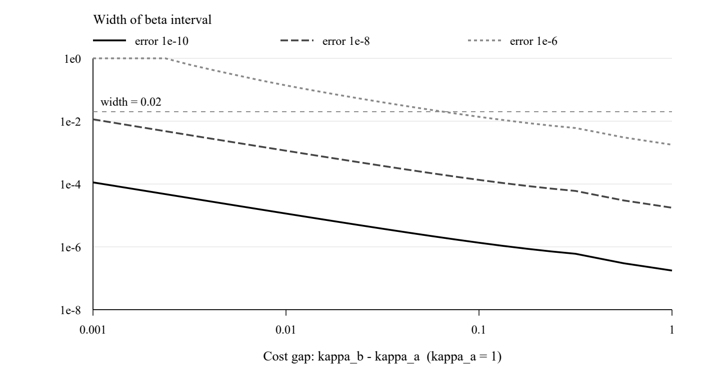

# 未知报告平滑下的交易规则识别

两个费用设置需要多少响应数据？

2026年10月31日 · 结构与表达修订版

## 摘要

交易规则调整缓慢，既可能因为其跨期目标不同，也可能因为私人目标持续较久，或对外报告经过了平滑处理。只观察调整速度，难以区分这三种原因。本文研究一个权限明确的程序识别问题：已知风险系数与折现参数的关系，允许在两个不同的内部调整费用下重复同一零状态试验，但不知道目标组成和共同报告平滑参数。目标可以包含任意多个正权重的衰减成分。我们证明，在无测量误差时，每个费用设置的前六个响应系数足以识别折现参数和报告记忆参数；如果任一设置最多只有五项，则无论另一设置读取多长的固定有限前缀，都不能保证对全部允许模型完成识别。因此，两个固定费用设置至少各需六项。

为说明这一结论何时能用于有限精度的数据，本文给出可执行的参数区间算法。同一条读数在不同方程中的误差始终来自同一个误差变量；程序据此计算包含全部可能合法参数的区间，并在区间过宽时拒绝作出精确判断。重新执行的合成试验表明，费用间隔、测量精度和目标持续性会明显影响区间宽度；较慢目标带来的困难，有相当一部分来自信号幅度减小。本文的结果适用于具有内部费用控制、状态复位和共同指数平滑报告权限的程序测试，不等同于从市场交易数据中恢复投资者偏好，也尚未构成机构实证。

关键词：交易规则；系统识别；折现参数；指数平滑；测量误差。

## 1 研究问题：慢响应来自决策，还是来自报告？

设想一项程序验收任务：委托人希望核实交易程序采用的跨期参数，但程序不披露其内部目标组成。委托人能改变程序内部的调整费用，并读取试验开始后逐期发布的响应。困难在于，发布端可能对实际持仓作了平滑。相同的慢响应，可能由程序本身的调整惯性产生，也可能来自持续的内部目标或报告记忆。将观察到的速度直接解释为折现参数，缺少识别依据。

本文只回答一个问题：在两个预先选定的费用设置下，至少需要读取多少个最早发布的响应系数，才能排除不同折现参数的解释？这里的“前缀”指从第零期开始连续读取的一段数据。研究从精确读数出发，再考察读数存在误差时能给出多窄的参数区间。这是同一识别问题的两种信息条件，不另设盈利预测或完整经济验收任务。

交易费用下的部分调整模型为这一问题提供了建模基础[1]。共同未知输入与多通道输出的识别也有成熟研究，例如[2]讨论压缩多通道盲反卷积的确定性识别条件。但其信号类别、测量方式和本文不同，不能直接用其测量数量替代本文连续前缀的数量。本文用到的正矩方法属于经典工具[3]，附录会直接给出本证明所需的构造。相对于这些基础，本文集中呈现的是：在下文规定的模型族中，两个费用设置各六项是否既足够、又不可进一步减少。我们不将一般的消元、矩方法或区间误差控制本身作为原创贡献；与最接近逆控制文献的全面定理对照仍需补足。

这一问题有实际意义，也有明确的适用门槛。若委托人确有这些权限，最少读取量可以指导试验布局，误差区间可以决定是否继续采集数据。若只有外部市场价格和成交记录，既不能改变内部费用，也不能保证试验复位，则本文不提供可直接套用的识别方案。

## 2 模型与可获得的信息

### 2.1 决策程序及其未知目标

以一个时期为时间单位，持仓与目标使用同一单位。程序从零持仓开始，即 \(p_{-1}=0\)，选择持仓路径，最小化

\[
J_{\beta,\kappa}(p)=\sum_{n=0}^{\infty}\beta^n
\left\{\frac{\rho\beta}{2}(p_n-d_n)^2+
\frac{\kappa}{2}(p_n-p_{n-1})^2\right\}.
\tag{1}
\]

其中 \(0<\beta<1\) 是待识别的折现参数；\(\kappa>0\) 是调整费用系数；\(\rho>0\) 已知。两个平方项分别惩罚偏离目标和过快调整，其系数具有相同量纲。式（1）规定目标偏离系数等于 \(\rho\beta\)。这是一项实质限制：改变 \(\beta\) 时，折现和该系数同时变化。因此，本稿识别的是这一参数化程序中的 \(\beta\)，不能将其直接称为一般投资者纯粹的“耐心程度”。

目标由一组逐渐衰减的成分构成：

\[
d_n=\int_{[0,1)}(1-s)s^n\,\mu(ds).
\tag{2}
\]

\(s\) 表示持续性；越接近1，衰减越慢。\(\mu\) 是有限、非零的正测度；离散情形就是若干非负衰减序列的严格正权重混合，其成分数量和总权重都未知，数量没有预设上限。允许 \(s=0\) 的一次性成分。正性排除了正负成分相互抵消，这是后文六项充分性的关键条件，不能随意删去。

费用 \(\kappa\) 可以取任意正实数。本文从连续范围内选取两个固定值 \(\kappa_a<\kappa_b\)，并不要求一倍、两倍或三倍的整数关系。它是优化器实际使用的内部系数，不是外部观察者从市场上自然就能确认的交易摩擦。\(\rho\) 同样需要通过设计文档或可信配置获得；若未知，就超出了本文定理。实验中的1和2只是便于复核的数值选择。

### 2.2 实际响应与发布的响应

内部费用决定一个持仓调整系数 \(E_\kappa\in(0,1)\)：

\[
\kappa\frac{(1-E_\kappa)(1-\beta E_\kappa)}{E_\kappa}=\rho\beta,
\qquad
E_\kappa=\frac{2}{b_\kappa+\sqrt{b_\kappa^2-4\beta}},
\quad b_\kappa=1+\beta+\rho\beta/\kappa.
\tag{3}
\]

式（3）的左侧随 \(E_\kappa\) 在 \((0,1)\) 上严格下降，从无穷大降至零，故解唯一；费用越大，解越大，持仓调整越慢。记 \(F_\kappa(z)=\sum_{n\ge0}p_{\kappa,n}z^n\) 为实际持仓响应的生成函数。由式（1）的最优性条件可得

\[
F_\kappa(z)=\int_{[0,1)}
\frac{(1-E_\kappa)(1-\beta E_\kappa)(1-s)}
{(1-E_\kappa z)(1-\beta E_\kappa s)(1-sz)}\,\mu(ds).
\tag{4}
\]

生成函数只是在一个式子中排列各期响应的工具；后文计算只用有限个系数。式（4）的推导见附录A。

观察者读到的不是 \(p_{\kappa,n}\)，而是它经过同一指数平滑器后的发布值：

\[
Z_{\kappa,n}=rZ_{\kappa,n-1}+g p_{\kappa,n},\qquad
Z_{\kappa,-1}=0,\quad 0<r<1,\quad g>0.
\tag{5}
\]

报告记忆参数 \(r\) 和增益 \(g\) 都未知，但在两个费用设置间不变。一般情形不要求 \(g=1-r\)；数值基准采用这一归一化。式（5）等价于 \(Z_\kappa(z)=gF_\kappa(z)/(1-rz)\)。我们试图分离的是决策参数 \(\beta\) 与报告记忆 \(r\)，而不是把 \(E_\kappa\)、目标持续性 \(s\) 和 \(r\) 混称为同一种“惯性”。

### 2.3 每项权限为什么必要

| 需要的条件或权限 | 在推理中的作用 | 实际应如何提供 |
| --- | --- | --- |
| 已知 \(\rho\)，且系数关系为 \(\rho\beta\) | 规定可识别的参数化模型 | 可信程序规范与配置 |
| 可设置两个不同的内部 \(\kappa\) | 用跨费用变化消去共同目标 | 测试接口直接控制内部系数 |
| 同一目标组成、同一报告链 | 保证两次响应可作消元 | 冻结输入与发布端配置 |
| 持仓、目标响应时钟和报告状态可复位 | 使零期边界关系成立 | 可重复的隔离试验 |
| 正目标混合、单极点指数平滑 | 排除证明中的退化解释 | 模型规范；数据只能部分反驳 |

这张表规定的是接口条件，不是已在现实机构中验证过的事实。单次拟合成功不能确认这些条件全部成立。

## 3 核心结果：两个费用设置必须各有六项

**定理1（最少读取量）。** 固定任意已知 \(\rho>0\) 和 \(0<\kappa_a<\kappa_b\)。在第2节全部条件下，两个设置各自的前六项 \(Z_{i,0},\ldots,Z_{i,5}\) 唯一确定 \(\beta\) 和 \(r\)。反之，只要任一设置最多读取五项，无论另一设置读取多少项预先固定的有限前缀，都存在两个符合全部条件、折现参数不同而已读报告逐项相同的模型。因此，对整个允许模型族保证识别，当且仅当两个前缀长度都至少为六。

这里的十二项是十二个响应系数，不是十二次含噪试验。定理也不声称能够恢复目标组成、目标总权重或报告增益。

定理给出的指导很具体：在权限已经满足时，增加单一费用下的记录长度，不能普遍弥补另一费用只有五项的缺口。应先保证两个设置都覆盖六个最早响应，再讨论提高精度或增加记录。它没有说明六个带误差的数值一定足够准确，也不比较第三费用等其他权限布局。

### 3.1 六项怎样给出参数

先将两条报告作两个差分组合，再比较相邻时期：

\[
\begin{aligned}
C_n&=\kappa_b Z_{b,n}-\kappa_a Z_{a,n},&D_n&=Z_{b,n}-Z_{a,n},\\
W_n&=C_n-C_{n-1},&H_n&=C_{n+1}-C_n-\rho D_n,
\end{aligned}
\qquad C_{-1}=0.
\tag{6}
\]

其中费用加权组合用于消去共同目标，时间差分用于消去报告记忆。记 \(t=\beta r\)，最优性条件和零状态边界给出以下线性方程：

\[
\begin{pmatrix}
H_0&0&-C_0\\
H_1&W_0&-H_0\\
H_2&W_1&-H_1\\
H_3&W_2&-H_2\\
H_4&W_3&-H_3
\end{pmatrix}
\begin{pmatrix}\beta\\r\\t\end{pmatrix}
=\begin{pmatrix}C_0\\W_1\\W_2\\W_3\\W_4\end{pmatrix}.
\tag{7}
\]

\(H_4\) 用到 \(C_5\)，因此六项足以建立整个方程组。第一行来自试验开始时的边界，不是可以丢弃的稳态关系。对精确数据，解出三个未知数，再检查 \(t=\beta r\)。

写出方程还不等于证明识别：若矩阵在某些合法目标下失去列满秩，解仍可能不唯一。本定理的充分性恰恰要排除所有这些情况，而不能只报告一般位置满秩或若干数值例。

### 3.2 为什么正目标能保证唯一解

完整证明见附录B，关键逻辑如下。先把共同目标重新加权为一个概率分布，将费用组合的前几个系数写成该分布的矩。假设式（7）有非零齐次解，就会迫使这些矩满足一种特殊的几何递推。这个递推又迫使一个由正权重构成的分布方差为零，因此其质量只能集中在一个持续性点上。但把这一单点形式代回初始矩关系，会得到一个严格正的量必须等于零。纯一次性目标也单独导致矛盾。于是所有允许目标下的矩阵都列满秩。

这里的洞见不是“多列几条方程通常就够了”，而是目标正性使潜在的退化递推无法实现。若允许负权抵消，这一步便失去依据。相反，证明无需知道目标含有多少成分，因此不应把它解释成对某个固定低阶拟合模型的参数计数。

### 3.3 为什么五项不能普遍保证识别

必要性也不能仅用“未知数多于方程”说明。我们必须构造两个完整、合法的程序，证明它们的已读报告真的相同。

附录C先构造位于正矩条件内部的目标分布，使折现参数和报告记忆可以同时作小幅变化，而前五项报告保持不变；随后调整正权重，使较长通道的全部有限记录也保持不变。因为原权重严格为正，小扰动后仍为正。得到的第二模型既满足最优性条件，也有合法目标和报告链。因此，即使另一费用的数据远多于五项，歧义仍可能存在。

这是对全部允许模型的保证下界，不代表每个具体五项数据都必然有歧义，也不保证两组不可区分参数相距很远。它支持的是最低试验布局，不是统一的测量精度预算。

## 4 有测量误差时，报告一个区间

### 4.1 保留同一读数的重复使用关系

实际读数记为 \(y_j\)，真实读数是 \(y_j+e_j\)，且每个 \(|e_j|\le\varepsilon_j\)。下标 \(j\) 遍历两条前缀中的原始读数。同一读数在式（6）和式（7）中出现多次时，必须使用同一个 \(e_j\)。这不要求各误差独立，也不把十二条误差界自动解释成某个联合置信水平。

从式（7）选三行，在名义读数下记为 \(A_0u=b_0\)，其中 \(u=(\beta,r,t)^\top\)。由于方程系数对原始读数是线性的，真实关系可以写成

\[
\left(A_0+\sum_j e_j A_j\right)u=b_0+\sum_j e_j b_j.
\tag{8}
\]

这里的 \(A_j,b_j\) 先合并同一个读数的全部作用，再进行误差控制。若将这些重复作用各自赋予独立误差，就改变了原问题。

**命题2（可计算的参数区间）。** 若 \(A_0\) 可逆，令 \(T=A_0^{-1}\)、\(u_0=Tb_0\)，并逐元素定义

\[
q_j=T(b_j-A_j u_0),\qquad G_j=TA_j,\qquad
d=\sum_j\varepsilon_j|q_j|,\qquad M=\sum_j\varepsilon_j|G_j|.
\tag{9}
\]

若 \(M\) 的最大行和小于1，则每个满足模型和误差界的真实参数都满足

\[
|u-u_0|\le (I-M)^{-1}d.
\tag{10}
\]

证明只需把式（8）减去名义方程。令 \(v=u-u_0\)，有 \(v=\sum_j e_jq_j-\sum_j e_jG_jv\)，从而 \(|v|\le d+M|v|\)。行和条件保证 \((I-M)^{-1}\) 存在且逐元素非负，左乘即得式（10）。这一步随后会以区间方式放宽依赖关系，但放宽方向始终保守，不是假定误差独立。

命题的作用是把“精度足够小时可以识别”变成当前数据上可检查的计算。它的局限同样重要：这只是包含全部合法参数的外包区间，区间内每一点未必都能由合法正目标实现；条件失败只说明本算法没有给出这一保证，并不证明任何算法都无法识别。

### 4.2 程序何时给结论，何时停止判断

程序检查五行中全部十个三行子组，将可用区间相交，再与 \(0\le\beta,r,t\le1\) 及 \(t=\beta r\) 的区间约束相交。最后用全部五行作残差排除。可逆性、收缩条件、区间端点和排除判断采用有理数运算；浮点运算只作诊断，不决定包含保证。附录D给出残差界。

输出按其含义分为三类。第一，模型、已知配置与误差界不能共同解释数据；这时只能报告不一致，不能仅凭这一结果认定是哪项假设错误。第二，所有合法解释都落在一个足够窄的区间内；这时给出条件性的参数区间。第三，尚不能排除模型，但区间太宽或未通过收缩检查；这时拒绝给出精确判断，同时保留当前保守区间。

实验把允许的 \(\beta\) 区间宽度设为0.02，仅作为预先固定的展示标准。实际验收应依据参数偏差的容忍度另行设定。区间不包含约定值，可以在模型成立和误差界可信的前提下反驳该值；区间包含约定值，不能据此宣布程序完全合格。这正是本结果能够提供、也只能提供的决策支持。

没有额外信号下限时，不存在全模型族通用的固定绝对精度。取总质量为1的单一目标 \(\mu=\delta_s\)，令 \(s\to1\)，其目标和每个固定期响应都趋于零。任意两个不同折现参数的有限报告因而可以同时落入同一固定绝对误差范围。这个现象首先说明信号会消失，不应直接解释成经济损害变大。

## 5 数值检查：六项在什么精度下有用？

### 5.1 生成系统、误差设置和复核范围

本节使用可控合成系统，不使用真实市场数据。隐藏端按式（1）至式（5）递推生成持仓和报告，审计端只收到 \(\rho\)、费用、报告前缀和误差界，不接收真实 \(\beta\)、目标权重、调整系数或报告参数。生成端使用70位十进制计算，审计端用有理数执行区间判断；输入和输出逐条保存。

基准取 \(\beta=0.8\)、\(\rho=1\)、\(r=0.6\)、\(g=0.4\)，目标持续性为 \((0.1,0.45,0.8)\)，权重为 \((0.3,0.4,0.3)\)，费用为1和2。每个费用读取六项。新实验以高精度生成的报告作为误差区间中心，\(\varepsilon\) 表示允许的绝对测量误差；没有加入随机噪声，也没有重复抽样置信区间。保留的48位以上计算精度远高于最小的 \(10^{-12}\) 误差级别，但这仍是数值生成；另有精确有理数案例检验零误差恢复。

2026年10月31日在本机实际执行旧实验70组和新增实验96组。旧实验包含有界扰动、报告失配、不可区分模型及第三费用探索；本稿只讨论与两费用主线有关的结果，完整记录保留。新增实验包括75组连续费用间隔选点、10组目标持续性比较、5组误差水平和6组报告失配。90组合乎模型的数据，真实 \(\beta\) 均在输出区间内；6组报告失配中4组被排除，2组因区间过宽而未作精确判断。这些是实现检查，不是统计覆盖率估计，也不是独立同行复现。

### 5.2 误差与连续费用间隔

表1先固定费用和模型，只改变误差界。精确可识别不代表给定精度下有用：当误差界从 \(10^{-8}\) 提高到 \(10^{-4}\) 时，区间由约 \(1.76\times10^{-5}\) 扩大到0.433，程序拒绝给出精确结论。

表1　基准模型下的误差界与折现参数区间宽度

| 绝对误差界 | 区间宽度 | 是否达到宽度0.02标准 |
| --- | --- | --- |
| \(10^{-12}\) | \(1.758\times10^{-9}\) | 是 |
| \(10^{-10}\) | \(1.758\times10^{-7}\) | 是 |
| \(10^{-8}\) | \(1.758\times10^{-5}\) | 是 |
| \(10^{-6}\) | 0.001779 | 是 |
| \(10^{-4}\) | 0.433125 | 否 |

图1固定 \(\kappa_a=1\)，令 \(\kappa_b=1+\Delta\)，在 \(10^{-3}\le\Delta\le1\) 上取25个对数等距点，而非只比较整数倍费用。三条曲线采用相同的报告生成规则及不同误差界。选点之间的连线仅帮助阅读，不代表连续范围上的证明。

图1　两条费用越接近，消元使用的跨费用差异越小，在本组设置下区间通常越宽。纵轴为算法给出的区间宽度，达到1时可能仅剩物理范围。虚线为0.02展示标准。图中结果不证明任意模型下“费用越远越好”，也没有计入改变费用的实施成本。

实际安排试验时，费用间隔应允许程序行为发生可测变化，但同时需要考虑接口可用范围和试验成本。该图支持在已知可行范围内比较候选设置，不能给出一个脱离模型和测量条件的最优倍数。

### 5.3 慢目标：信号变小与区间变宽

为避免把信号幅度下降误写成纯粹的识别退化，表2将单一目标的持续性从0.8提高到0.9999，分别使用固定绝对误差 \(10^{-8}\) 和相对信号尺度的误差 \(10^{-6}P\)，其中 \(P\) 为该例十二项真实报告的最大绝对值。后一列是用于分解原因的合成比较；现实中 \(P\) 未必已知，需要另行取得可信误差界。

表2　相同慢目标在两种误差标准下的结果

| 持续性 \(s\) | 报告峰值 \(P\) | 固定绝对误差的区间宽度 | 按峰值缩放误差的区间宽度 |
| --- | --- | --- | --- |
| 0.8 | 0.09685 | 0.0000916 | 0.000888 |
| 0.95 | 0.03757 | 0.000638 | 0.002403 |
| 0.99 | 0.008747 | 0.003792 | 0.003316 |
| 0.999 | 0.0009051 | 0.04065 | 0.003555 |
| 0.9999 | 0.00009081 | 0.50812 | 0.003580 |

固定绝对误差下，最后两个例子超过0.02标准；按峰值缩放后则均低于标准。这说明不能忽略信噪尺度。缩放后的宽度仍随持续性变化，说明相同相对精度也不使各模型同样容易。但这五个选点不足以证明存在某个全族统一相对精度界。

另两类失配检查故意让两费用的报告记忆不同，或在报告中混入第二个平滑极点。低误差下程序排除了两类数据；误差较大时两类都未能排除，且区间过宽。未被排除并不证明模型正确。这一结果要求应用者同时报告读数精度和模型适配证据，不能把“算出了一个参数”当作成功标准。

## 6 适用范围与尚未解决的问题

本文给出了一个明确但受限的答案：在已知风险关系、内部费用可控、状态可复位、正目标混合和共同指数平滑报告下，两个固定费用的连续响应前缀必须各有六项，且六项足够。正性排除了精确数据的代数退化；区间计算进一步说明，同样的读取量在有限精度下可能提供窄区间，也可能只能拒绝判断。

因此，实际价值应按信息权限评价。在软件验收或隔离测试中，若这些权限可以提供，结果能帮助分配读取预算、选择候选费用间隔，并识别当前精度是否足以核查约定参数。在普通市场数据分析中，这些权限通常不能从观测本身获得；本文没有解决这种较弱接口的问题，也没有证明恢复 \(\beta\) 能提高收益或改善完整资源配置。

本稿仍有三项主要限制。第一，未验证真实机构同时具备所需权限。第二，区间算法给出保守外包，不求精确的正目标可行参数集合，其拒答可能来自算法保守性。第三，最接近文献的全面原创性对照尚未闭合。因此，后续应优先检验可提供的实际接口和可接受的精度，再讨论增加报告机制、扩充理论分支；不能用更多小结论替代这两项核查。

## 参考文献

[1] Gârleanu, N., and Pedersen, L. H. (2013). Dynamic Trading with Predictable Returns and Transaction Costs. The Journal of Finance, 68(6), 2309–2340. DOI: 10.1111/jofi.12080. 作者版本：https://docs.lhpedersen.com/DynamicTrading.pdf 。

[2] Mulleti, S., Lee, K., and Eldar, Y. C. (2020). Identifiability Conditions for Compressive Multichannel Blind Deconvolution. IEEE Transactions on Signal Processing. DOI: 10.1109/TSP.2020.3011804. 公开版本：https://arxiv.org/abs/2001.00613 。

[3] Curto, R. E., and Fialkow, L. A. (1991). Recursiveness, Positivity, and Truncated Moment Problems. Houston Journal of Mathematics, 17(4), 603–635. 原文：https://hjm.math.uzh.ch/v017n4/0603CURTO.pdf 。

## 附录A 从最优性条件到持仓响应

对式（1）的 \(p_n\) 求一阶条件，令 \(\alpha=\rho\beta\)，得到

\[
[\alpha+\kappa(1+\beta)]p_n-\kappa p_{n-1}-\kappa\beta p_{n+1}=\alpha d_n.
\tag{A1}
\]

二次目标严格凸。目标有界，选取有界的最优路径时，无穷远的折现边界项消失，一阶条件既必要又充分。取式（3）的稳定解 \(E\)，有 \(\alpha=\kappa(1-E)(1-\beta E)/E\)。定义

\[
\ell_n=(1-\beta E)\sum_{j=0}^{\infty}(\beta E)^j d_{n+j},\qquad
p_n=E p_{n-1}+(1-E)\ell_n.
\tag{A2}
\]

代入（A1）即可逐项验证；（A2）有界且满足 \(p_{-1}=0\)，故为唯一有界最优路径。对于单一目标 \(d_n=(1-s)s^n\)，几何级数给出

\[
\ell_n=\frac{(1-\beta E)(1-s)s^n}{1-\beta Es}.
\]

把（A2）对 \(n\) 求生成函数，得到式（4）的单一成分表达。有限正测度及有界非负核允许交换求和与积分，因而结论适用于式（2）的全部混合目标。

## 附录B 六项充分性的证明

### B.1 将未知目标转化为矩关系

以下仅用于证明，不要求观察者知道这些量。写 \(E_a<E_b\)，定义

\[
a_E=E_a+E_b,\qquad p_E=E_aE_b,\qquad b_E=1-\beta p_E>0,
\quad C^F=\kappa_bF_b-\kappa_aF_a.
\]

利用 \(\kappa_i(1-E_i)(1-\beta E_i)=\rho\beta E_i\)，将式（4）通分，得

\[
C^F(z)=\frac{\rho\beta(E_b-E_a)}{(1-E_a z)(1-E_b z)}
\int\frac{(1-s)(1-\beta p_Ezs)}{(1-\beta E_as)(1-\beta E_bs)(1-sz)}\,\mu(ds).
\tag{B1}
\]

积分域均为 \([0,1)\)。其零阶系数 \(C^F_0>0\)。用权重 \((1-s)/[(1-\beta E_as)(1-\beta E_bs)]\) 重加权 \(\mu\)，再归一化为概率测度 \(\nu\)。记 \(m_n=\int s^n\nu(ds)\)、\(c_n=C^F_n/C^F_0\)，则 \(m_0=c_0=1\)、\(c_{-1}=0\)，且

\[
(1-a_Ez+p_Ez^2)\sum_{n\ge0}c_nz^n
=1+b_E\sum_{n\ge1}m_nz^n.
\tag{B2}
\]

因此 \(b_Em_n=c_n-a_Ec_{n-1}+p_Ec_{n-2}\)，\(n\ge1\)。这一步对连续分布及任意成分数量均成立。

### B.2 失去满秩会迫使什么递推

将式（6）的统计量用于未平滑的 \(F\)，以右上标 \(F\) 区分。令 \(D^F=F_b-F_a\)，式（4）通分后有

\[
[\beta-(1+\beta)z+z^2]C^F(z)-\rho\beta zD^F(z)=\beta C^F_0.
\]

比较两边的 \(z^{n+1}\) 系数，即 \(\beta C^F_{n+1}-(1+\beta)C^F_n+C^F_{n-1}-\rho\beta D^F_n=0\)，得到

\[
H^F_n=(C^F_n-C^F_{n-1})/\beta,\qquad C^F_{-1}=0.
\tag{B3}
\]

将共同报告滤波器卷积到（B3），并保留零期边界，得到

\[
\begin{aligned}
C_0&=gC^F_0>0,& H_0/C_0&=r+1/\beta,\\
W_n&=\beta H_n-\beta r C_0r^n,&
H_{n+1}-rH_n&=gH^F_{n+1}.
\end{aligned}
\tag{B4}
\]

这些等式也逐行验证了式（7）。设该矩阵有非零齐次向量 \((u,v,w)\)。首行给 \(uH_0=wC_0\)。若 \(u=0\)，则 \(w=0\)；第二行再由 \(W_0=C_0>0\) 给 \(v=0\)，矛盾。故可令 \(u=1\)，记 \(a=H_0/C_0\)，有

\[
w=a,\qquad v=a^2-H_1/C_0.
\]

余下四行和（B4）给出

\[
H_{n+1}=fH_n+\beta r C_0vr^n\quad(n=0,1,2,3),
\qquad f=a-\beta v=C^F_1/C^F_0-1.
\tag{B5}
\]

相邻等式相减以消去 \(r^n\) 项，得 \(H^F_{n+2}=fH^F_{n+1}\)，\(n=0,1,2\)。再用（B3）及 \(c_1=1+f\)，可得

\[
c_n=\sum_{j=0}^{n}f^j,\qquad n=0,1,2,3,4.
\tag{B6}
\]

### B.3 正性排除该递推

把（B6）代入（B2），令 \(d=m_1-m_2\)，计算得到

\[
\begin{aligned}
m_1&=\frac{1+f-a_E}{b_E},&
d&=-\frac{(f-E_a)(f-E_b)}{b_E},\\
m_2-m_3&=fd,&m_3-m_4&=f^2d.
\end{aligned}
\tag{B7}
\]

若 \(\nu\ne\delta_0\)，则 \(d=\int s(1-s)\nu(ds)>0\)。概率测度 \(s(1-s)\nu(ds)/d\) 的均值和二阶矩分别为 \(f\) 与 \(f^2\)，方差为零。因此其质量集中于 \(f\)，且 \(0<f<1\)。原测度只能支持于 \(\{0,f\}\)，从而 \(m_1=d/(1-f)\)。另一方面，（B7）直接给出

\[
m_1-\frac{d}{1-f}
=\frac{(1-E_a)(1-E_b)}{b_E(1-f)}>0,
\tag{B8}
\]

矛盾。若 \(\nu=\delta_0\)，则 \(m_1=m_2=0\)，（B7）迫使 \(f=a_E-1=p_E\)，即 \((1-E_a)(1-E_b)=0\)，也矛盾。矩阵因而对全部允许模型列满秩，唯一解为 \((\beta,r,\beta r)\)。这完成充分性证明；它不提供矩阵最小奇异值的统一下限。

## 附录C 五项不足及不平衡布局的证明

### C.1 构造可作小扰动的正目标

固定 \(\rho,\kappa_a,\kappa_b\) 和任意 \(\beta\in(0,1)\)，取 \(f\in(E_a,E_b)\)。沿用附录B的 \(a_E,p_E,b_E\)，令 \(c_n=\sum_{j=0}^n f^j\)、\(m_0=1\)，并定义

\[
m_n=\frac{c_n-a_Ec_{n-1}+p_Ec_{n-2}}{b_E},\qquad n=1,2,3,
\quad c_{-1}=0.
\tag{C1}
\]

令 \(d=m_1-m_2\)。代数化简得到 \(0<m_1<1\)，以及

\[
\begin{aligned}
d&=-(f-E_a)(f-E_b)/b_E>0,&m_2-m_3&=fd,\\
m_1(1-f)-d&=(1-E_a)(1-E_b)/b_E>0,\\
f(1-m_1)-d&=p_E(1-\beta f)/b_E>0.
\end{aligned}
\tag{C2}
\]

定义矩阵

\[
A=\begin{pmatrix}1&m_1\\m_1&m_2\end{pmatrix},\qquad
B=\begin{pmatrix}m_1&m_2\\m_2&m_3\end{pmatrix},\qquad
A-B=\begin{pmatrix}1-m_1&d\\d&fd\end{pmatrix}.
\tag{C3}
\]

\(\det B=d[m_1(1-f)-d]>0\)，\(\det(A-B)=d[f(1-m_1)-d]>0\)，且两者左上元为正，所以 \(B\)、\(A-B\)、\(A\) 均正定。可选足够小的 \(\eta>0\)，使 \(B-\eta A\) 和 \((1-\eta)A-B\) 仍正定。

为避免依赖未展开的矩存在结果，下面直接构造表示。令 \(u=m_1\)、\(v=m_2-u^2>0\)，并设

\[
J=\begin{pmatrix}u&\sqrt v\\ \sqrt v&(m_3-2um_2+u^3)/v\end{pmatrix}.
\tag{C4}
\]

以 \((1,0)^\top\) 和 \((-u,1)^\top/\sqrt v\) 为列组成 \(L\)，可验证 \(L^\top A L=I\)、\(L^\top B L=J\)。因此 \(\eta I<J<(1-\eta)I\)。\(J\) 的两个特征值不同且位于 \((\eta,1-\eta)\)；非零非对角元保证相应单位特征向量的第一坐标非零。以特征值为节点、第一坐标平方为正权重，得到概率测度，其0至3阶矩为 \(e_1^\top J^je_1=m_j\)。

现任取长通道长度 \(N\ge5\)。在 \([0,\eta/2)\) 另选 \(N-1\) 个不同节点，从四个指定矩中减去这些节点各自足够小的正质量。剩余矩归一化后仍满足上述严格矩阵不等式，所以又能由高区间的两个节点表示。合并得到有 \(N+1\) 个不同节点、全部权重严格正的概率测度 \(\nu\)，其前三阶矩仍为（C1）。选择质量尺度 \(S>0\)，令

\[
\mu(ds)=S\frac{(1-\beta E_as)(1-\beta E_bs)}{1-s}\,\nu(ds).
\tag{C5}
\]

节点均小于1，故这是合法的有限非零正目标。

### C.2 保持前五项报告的参数变化

记 \(M_\nu(z)=\sum_{n\ge0}m_nz^n\)、\(A_i=(1-E_i)(1-\beta E_i)\)。由（C5）得

\[
F_a(z)=A_aS\frac{(z-\beta E_b)M_\nu(z)+\beta E_b}{z(1-E_az)},
\tag{C6}
\]

另一通道交换 \(a,b\)。消去 \(M_\nu\)，令 \(D^F=F_b-F_a\)，得到

\[
[\beta-(1+\beta)z+z^2]C^F-\rho\beta zD^F=\beta C^F_0.
\tag{C7}
\]

并有 \(C^F/C^F_0=[b_E M_\nu+\beta p_E]/[(1-E_az)(1-E_bz)]\)、\(C^F_0=\rho\beta S(E_b-E_a)>0\)。前三阶矩保证

\[
C^F(z)/C^F_0=\frac1{(1-z)(1-fz)}\pmod {z^4}.
\tag{C8}
\]

这里模 \(z^k\) 表示0至 \(k-1\) 阶系数相等。取足够小的 \(\delta>0\)，设置

\[
r=f+\delta,\quad g=1-r,\qquad
\beta'=\frac{\beta}{1+\beta\delta},\quad r'=f,\quad g'=1-f.
\tag{C9}
\]

它们都合法，且 \(\beta'\ne\beta\)。对同一原报告定义

\[
Q_\theta(z)=\theta[(1-z)C(z)-\rho zD(z)]-z(1-z)C(z),\qquad \theta\in\mathbb R.
\]

（C7）给 \((1-rz)Q_\beta=\beta C_0\)。（C8）又给

\[
z(1-z)C(z)=\frac{C_0z}{(1-fz)(1-rz)}\pmod {z^5}.
\]

利用 \(Q_{\beta'}=(\beta'/\beta)Q_\beta+(\beta'/\beta-1)z(1-z)C\) 和 \(\beta'/\beta-1=\beta'(f-r)\)，得到

\[
Q_{\beta'}(z)=\frac{\beta'C_0}{1-fz}\pmod {z^5}.
\tag{C10}
\]

所以原来两条前五项报告也满足第二参数的全部低阶跨费用约束。下面还须证明这些约束能由一个完整正目标实现。

### C.3 实现第二模型，并保留任意有限长通道

保留长通道前 \(N\) 项原报告和短通道前五项。用 \(r',g'\) 逆滤波，得待实现的 \(F'_i\)。新的 \(E'_a,E'_b\) 随 \(\beta'\) 连续。两个零期值确定 \(S'\) 和 \(S'm'_1\)：

\[
F'_{a,0}/A'_a=S'-\beta'E'_b S'm'_1,\qquad
F'_{b,0}/A'_b=S'-\beta'E'_a S'm'_1.
\tag{C11}
\]

因 \(E'_a\ne E'_b\)，该二元线性系统可逆。在长通道为 \(a\) 时，再用

\[
F'_{a,n}-E'_a F'_{a,n-1}
=A'_aS'(m'_n-\beta'E'_b m'_{n+1}),\qquad n=0,\ldots,N-1,
\tag{C12}
\]

递推恢复到 \(m'_N\)，其中 \(m'_0=1\)、\(F'_{a,-1}=0\)，且 \(\beta'E'_b\ne0\)。长通道为 \(b\) 时交换下标。零扰动时所有量回到原模型，故 \(S'\)、\(m'_0,\ldots,m'_N\) 均随扰动连续，且小扰动下 \(S'>0\)。

在原来的 \(N+1\) 个固定节点上，范德蒙德矩阵可逆，因此这些矩给出连续变化的 \(N+1\) 个权重。原权重严格为正，所以非零而足够小的扰动后仍全部为正。按（C5）的新参数版本转换，得到合法 \(\mu'\)，并由构造匹配长通道全部 \(N\) 项。

短通道初始项已经由（C11）匹配。其余四项由（C10）的消元约束依次确定：将（C6）两通道消去共同矩函数后，短通道每个当前系数的乘子为 \(\pm\beta'E'_{\mathrm{long}}/A'_{\mathrm{short}}\)，非零。因此同一长通道、同一零期值和这些约束唯一确定短通道前五项；第二正模型必然与之相同。

这构造了折现不同、全部指定报告相同的两个合法模型。任意一边不超过五项的有限布局，均可嵌入上述 \((5,N)\) 或 \((N,5)\) 布局后再截断。结合附录B，定理1得证。该连续性论证只保证足够小的非零参数变化，不给出具有统一正下限的歧义距离。

## 附录D 区间排除、实现与复核说明

命题2对每个可用三行子组在同一个原始误差界下成立，故根据数据选择子组再取区间交集，不引入额外概率事件。与闭范围 \([0,1]^3\) 相交只作为对开参数域的保守外包；用非负区间运算施加 \(t=\beta r\) 也保持包含性。

设当前参数区间中心为 \(c\)、半径为 \(h\)。对任一完整方程行，记名义行为 \(a_i\)、右端为 \(b_i\)，第 \(j\) 个原读数的系数为 \(a_{ij},b_{ij}\)。若

\[
|a_i c-b_i|>
|a_i|h+\sum_j\varepsilon_j\bigl(|a_{ij}c-b_{ij}|+|a_{ij}|h\bigr),
\tag{D1}
\]

则当前参数区间及全部允许误差均不能满足这一必要方程，可排除联合模型解释。式（D1）先合并同一误差在方程中的作用，再作三角不等式放宽。反之，未触发排除不构成正目标存在的充分性证明。

复核材料保留生成端、审计端、两个运行入口、全部逐输入结果、日志及哈希。原70组检查还包括一个精确有理数模型，恢复 \(\beta=4/5\)、\(r=3/5\)；13组定向共享误差检查；12组额外参数组合检查；以及一份同时允许 \(\beta=0.6\) 和0.85的共同输入，程序包含两者并拒绝精确判断。这些附加检查不计入新增96组，不将数量混写为独立样本量。运行环境与命令见成果目录中的复核说明。

本文的证明审查、代码执行和文字审读均由同一辅助研究流程完成，不能称为独立专家评审。理论一般性来自附录证明；数值检查只支持实现与示例结论。
